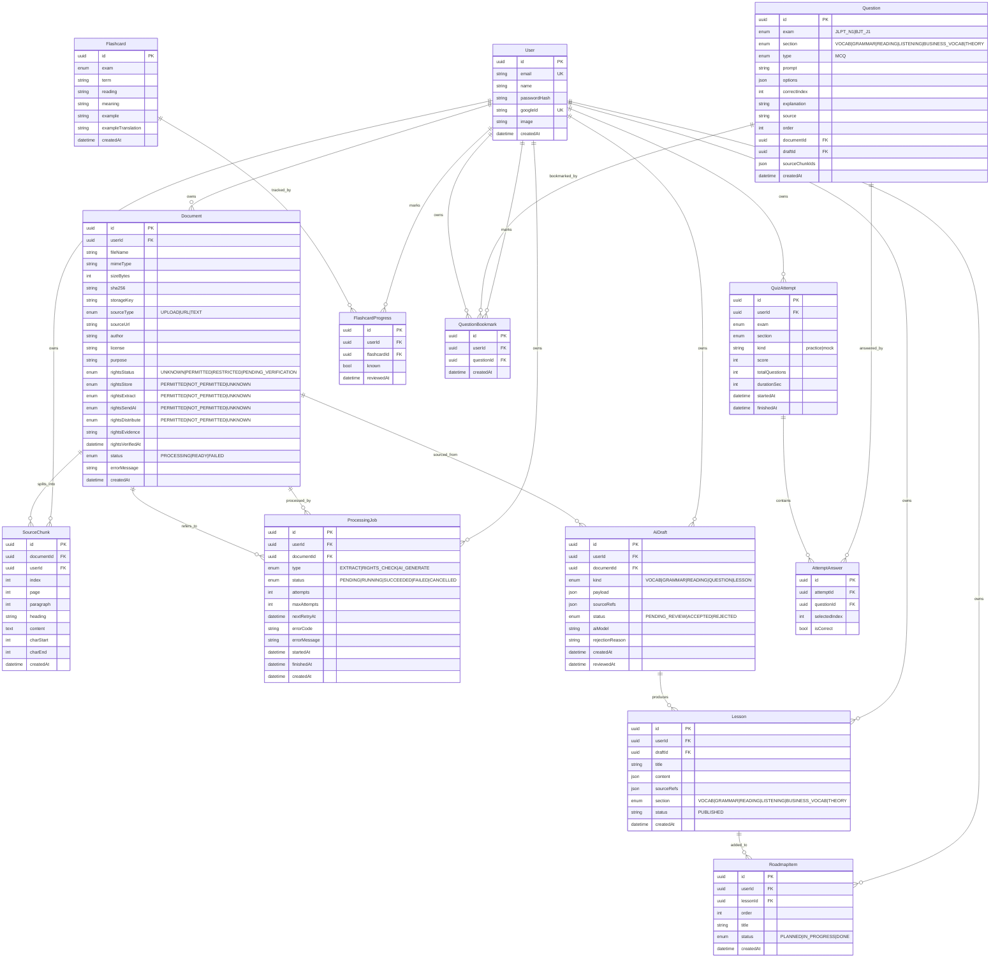

# ERD — Website ôn thi JLPT N1 & BJT J1

## Ghi chú
- Mọi bản ghi đều có `userId` (quyền sở hữu người dùng) — authz scope theo owner.
- Timestamp lưu UTC (Prisma DateTime), serialize ra ISO8601.
- `Document.rights*` phân biệt 4 quyền: lưu trữ / trích xuất / gửi AI / phân phối.
- `AiDraft.status = PENDING_REVIEW` → chỉ ACCEPTED mới tạo `Lesson`/`Question`.
- Nội dung **tạo thủ công** (`POST /api/content/manual`) ghi thẳng `Lesson`/`Question` với `documentId`/`draftId` = NULL (không qua AiDraft).
- `Question.section` là enum `Section` đầy đủ (gồm `THEORY`), nhưng luồng accept/materialize chỉ chấp nhận 5 phần thi: VOCAB, GRAMMAR, READING, LISTENING, BUSINESS_VOCAB.
- Unique constraints: `User.email`, `User.googleId`, `RoadmapItem(userId, lessonId)`, `FlashcardProgress(userId, flashcardId)`, `QuestionBookmark(userId, questionId)`.
- Indexes chính: `Document(userId)`, `SourceChunk(documentId, index)`, `ProcessingJob(status, nextRetryAt)`, `AiDraft(userId, status)`, `Question(exam, section)`, `RoadmapItem(userId, order)`.
- Migration files: `20261017135907_init` (v1) · `20261017142427_v2_content_pipeline` (v2) · `20261017233121_add_question_bookmark` · `20261018001500_add_theory_section_and_document_domain`.