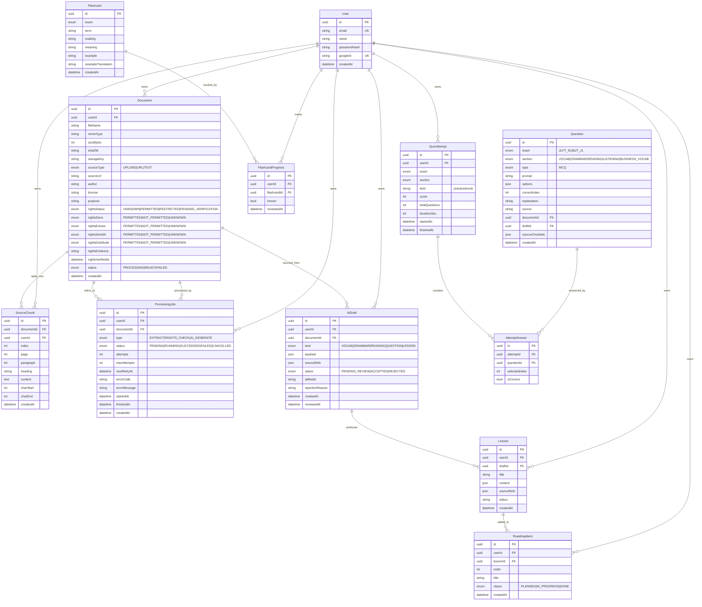

# ERD — Website ôn thi JLPT N1 & BJT J1

## Ghi chú
- Mọi bản ghi đều có `userId` (quyền sở hữu người dùng) — authz scope theo owner.
- Timestamp lưu UTC (Prisma DateTime), serialize ra ISO8601.
- `Document.rights*` phân biệt 4 quyền: lưu trữ / trích xuất / gửi AI / phân phối.
- `AiDraft.status = PENDING_REVIEW` → chỉ ACCEPTED mới tạo `Lesson`/`Question`.
- Migration files: `prisma/migrations/20261017135907_init` (v1), `20261017142427_v2_content_pipeline` (v2).